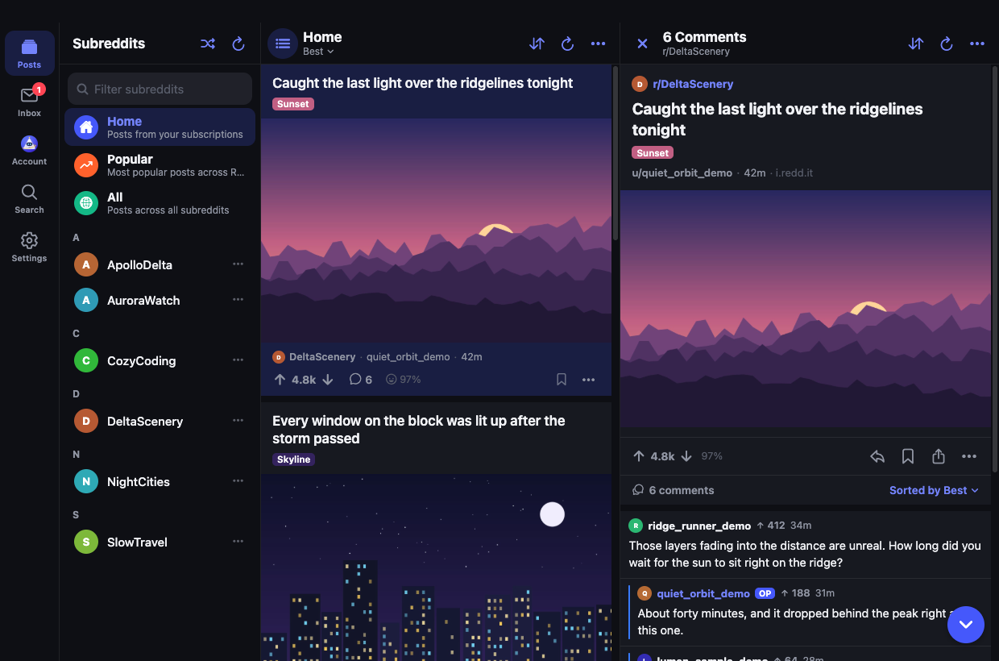
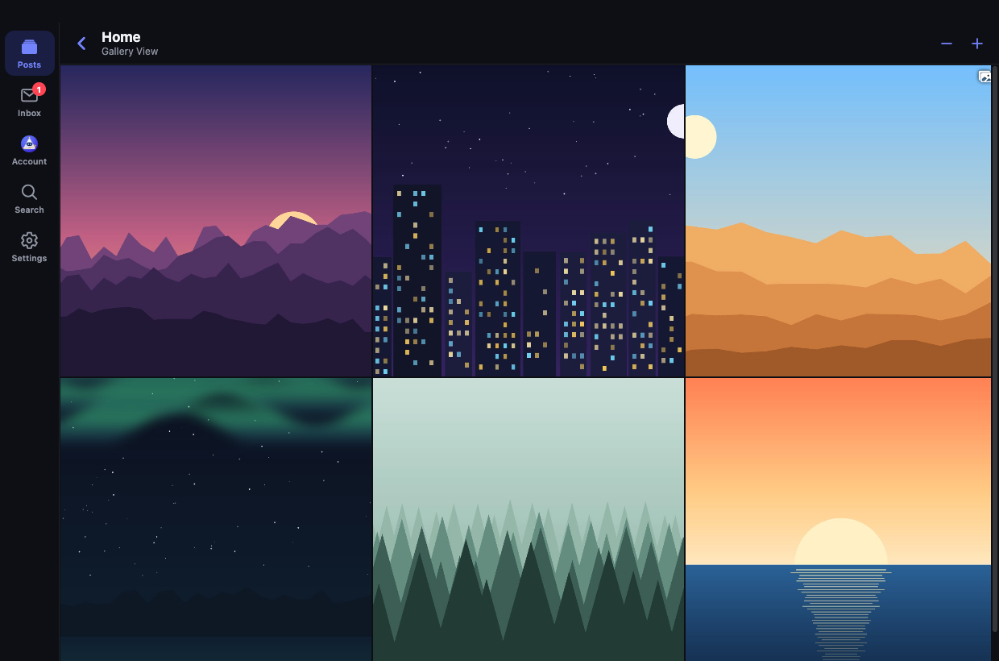
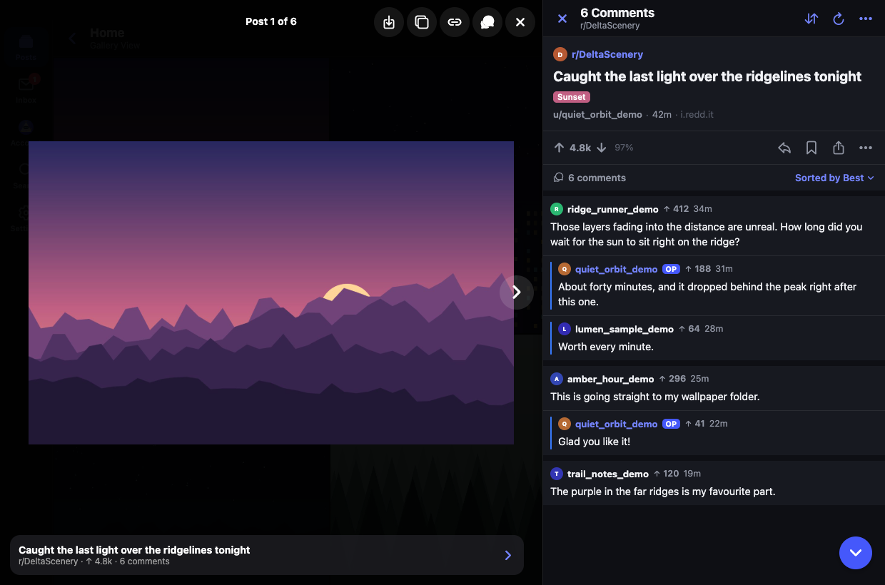
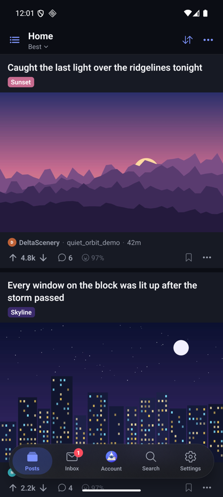
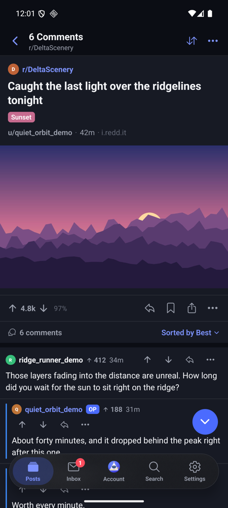
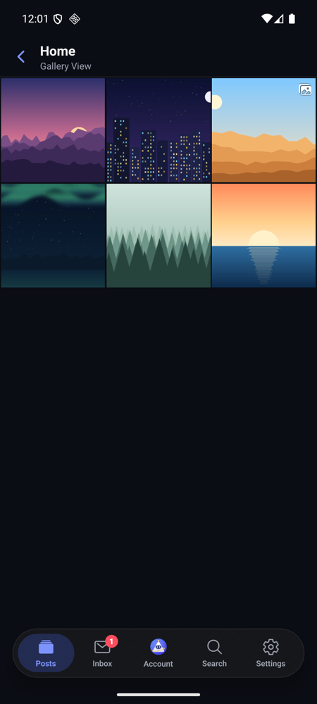
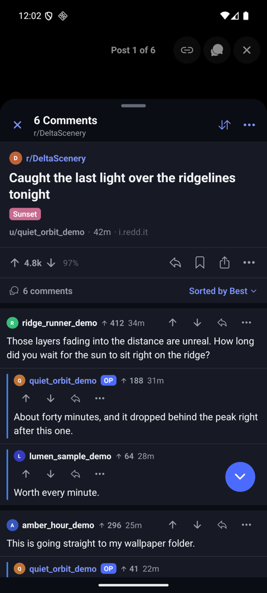
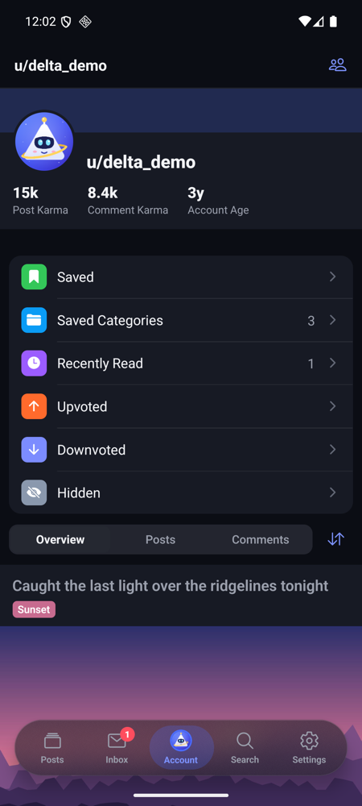

<p align="center"></p>

# Apollo Delta

A Reddit client inspired by [Apollo](https://apolloapp.io) and the community's [Apollo Reborn](https://apolloreborn.app), for **macOS**, **Windows** and **Android**.

**No API key needed.** You sign in on Reddit's own page (or with Google), and Apollo Delta reads Reddit with that session, the way your browser does.

Not affiliated with Reddit, Apollo or Apollo Reborn.

### Desktop

| | | |
|:--:|:--:|:--:|
|  |  |  |
| Three panes | Gallery View | Comments beside the picture |

### Android

| | | | | |
|:--:|:--:|:--:|:--:|:--:|
|  |  |  |  |  |
| Feed | Comments | Gallery View | Comments sheet | Profile |

<sub>Screenshots use the app's demo mode: the posts, people and pictures are samples made for Apollo Delta.</sub>

## Download

Get the latest from [Releases](https://github.com/Deli5150/apollo-delta/releases/latest):

- **Mac:** `ApolloDelta-x.y.z.dmg` (Apple silicon and Intel). The app isn't notarized: the first time, right-click it → Open.
- **Windows:** `ApolloDelta-Setup-x.y.z.exe`.
- **Android:** `ApolloDelta-x.y.z.apk`. Allow installing from your browser or file manager when Android asks.

Apollo Delta updates itself: it checks for new releases and offers to install them (Settings → Updates).

## Features

- **Feeds:** Home, Popular, All, subreddits, multireddits and favorites, with every sort. Large or compact posts.
- **Three panes on desktop:** subreddits, the feed, and the comments beside it once you pick a post.
- **Media:** pictures, galleries, Reddit videos with sound, GIFs, YouTube, inline images in comments, and rich link previews. Full-screen viewer and **Gallery View**, where the arrow keys step through posts and the comments open beside the picture.
- **Comments:** collapsing, load more, the **New Comments Highlightifier**, a jump button (next thread or next new comment), auto-collapsed pinned comments, profile pictures, and tap any time for its full date.
- **Do things:** vote, save (with your own **saved categories**), hide, reply, edit, delete, report, block; new text, link and image posts with flair; private messages.
- **Inbox:** replies, mentions and messages, with an unread badge and desktop notifications.
- **Search:** posts, subreddits and people, recent searches, recently visited and trending subreddits.
- **Profiles:** karma, trophies, posts and comments; your saved, upvoted, hidden and **recently read** posts.
- **Make it yours:** 12 themes in light and dark (and a hidden one), alternate app icons, text size, filters (keywords, subreddits, users, domains, flairs), tag filters for NSFW and spoilers with per-subreddit exceptions, NSFW in r/all, in-place translation.
- **Several accounts,** each with its own settings, favorites and history.
- **Backup and restore** of your settings.
- **On Android:** a floating dock on every page, pinch and double-tap to zoom pictures, pinch Gallery View for more or fewer columns, and comments that slide up from the bottom.

## How it works without an API key

Reddit refuses signed-out requests for its JSON pages, but serves them to a signed-in web session. Apollo Delta signs you in on reddit.com in a window with its own cookie store, then sends its requests from the app with that session and a browser's User-Agent; votes and comments carry the session's modhash. Some pages are blocked on www.reddit.com for web sessions but still served on oauth/old/api.reddit.com, so each kind of request has hosts to try in order (`src/lib/reddit/routes.ts`), and [`routes.json`](routes.json) here can change that list without an app update. This is the approach Apollo Reborn's API-Key-Free Mode uses.

Google won't sign in inside apps, so on desktop **Sign in with Google** opens Reddit's sign-in in a separate window of your Chrome, Edge or Brave (never your own profile), then takes the Reddit session from there. On Android, Reddit's sign-in page shows Google's sign-in in its own window.

## Building

Requires Node 22+.

```sh
npm install && (cd desktop && npm install)
npm run dev            # desktop app with live reload
npm run typecheck && npm test
npm run dist:desktop   # dmg, mac.zip and Setup.exe in dist/
npm run release        # publish dist/ as a GitHub release (needs a CHANGELOG.md section)
```

Android: `npx expo prebuild -p android`, then `npm run dist:android` (needs JDK 17).

Icons: edit `assets/src/icon.svg`, then `npm run icons`.

Demo mode (sample posts, nothing sent to Reddit): `DELTA_DEMO=1` when starting the desktop app, or open `apollodelta://demo` on a phone.

## License

MIT
